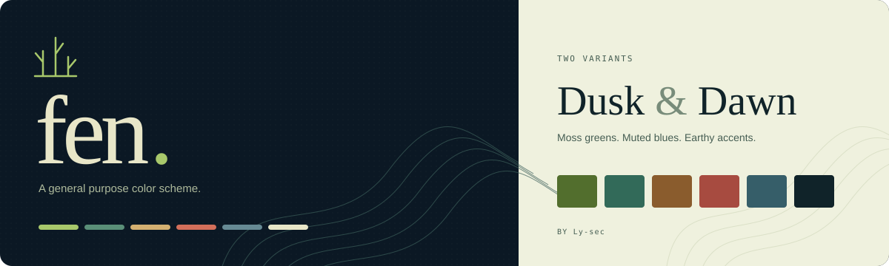

<p align="center">
  
</p>

<p align="center">
  A general purpose color scheme for editors, terminals and interfaces.
</p>

<p align="center">
  <a href="#palette">Palette</a> &nbsp;·&nbsp;
  <a href="#formats">Formats</a> &nbsp;·&nbsp;
  <a href="#development">Development</a>
</p>

## Palette

Fen combines moss greens, muted blues and earthy accents. **Dusk** pairs a deep blue background with ivory text. **Dawn** uses a pale green background and darker accents.

| Variant | Background | Text | Accent |
| :--- | :--- | :--- | :--- |
| **Dusk** | `#0B1824` | `#E8E6C8` | `#A8C86B` |
| **Dawn** | `#EFF1DE` | `#102329` | `#526E2D` |

Both variants live in [`colors.txt`](colors.txt). It stores the full palette in Noctalia's JSON format and supplies every export and preview.

## Formats

| Format | Includes | Files |
| :--- | :--- | :--- |
| **Noctalia** | Original UI and terminal colors, both variants | `fen-noctalia.json` |
| **Base16** | 16 roles for compatible theme builders | `fen-dusk-base16.yaml`, `fen-dawn-base16.yaml` |
| **Base24** | 24 roles with separate normal and bright accents | `fen-dusk-base24.yaml`, `fen-dawn-base24.yaml` |
| **CSS** | Named custom properties, both variants | `fen.css` |
| **Kitty** | Terminal colors, cursor and selection | `fen-dusk-kitty.conf`, `fen-dawn-kitty.conf` |

Run `npm run build` to generate these files in `dist/downloads/`, along with the static website.

Noctalia and Kitty preserve the original colors. Base16 uses the bright Dusk accents and normal Dawn accents for syntax; Base24 retains separate normal and bright accents. A few supporting shades are derived. The mappings are defined in [`src/theme.js`](src/theme.js).

Base16 and Base24 files are inputs for a compatible theme builder. CSS variables use `data-fen="dark"` or `data-fen="light"` on the root element:

```css
body {
  background: var(--fen-water);
  color: var(--fen-reed);
}

a {
  color: var(--fen-moss);
}
```

## Development

Requires **Node.js 20+**. There are no package dependencies to install.

```sh
npm run dev     # Preview at http://localhost:5173
npm test        # Check both palettes and their exports
npm run build   # Generate the site and downloads in dist/
```

The preview server builds on startup. After editing files, restart it or run `npm run build` to refresh the page.

| Path | Purpose |
| :--- | :--- |
| [`colors.txt`](colors.txt) | Source colors for Dusk and Dawn |
| [`src/`](src/) | Website, previews and palette adapters |
| [`scripts/`](scripts/) | Build script, preview server and tests |
| [`.github/workflows/deploy-pages.yml`](.github/workflows/deploy-pages.yml) | GitHub Pages deployment |

<details>
<summary><strong>Deployment</strong></summary>

The complete site is generated in `dist/`. All asset paths are relative, so it works at a domain root or a project path such as `/fen/`.

GitHub Pages is configured to use GitHub Actions. Every push to `main` runs the palette checks, builds the site and deploys it. The workflow can also be started manually from the Actions tab. No extra secrets are needed.

The deployment URL appears in the workflow result and the repository's Pages settings. For forks, select **GitHub Actions** under **Settings → Pages → Build and deployment**.

</details>

## License

[MIT](LICENSE) © 2026 Ly-sec.
